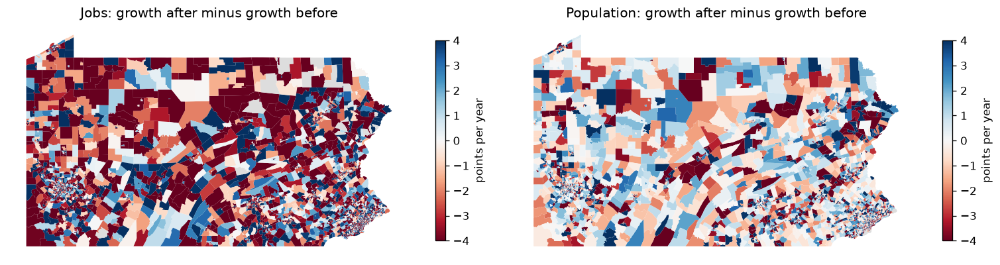
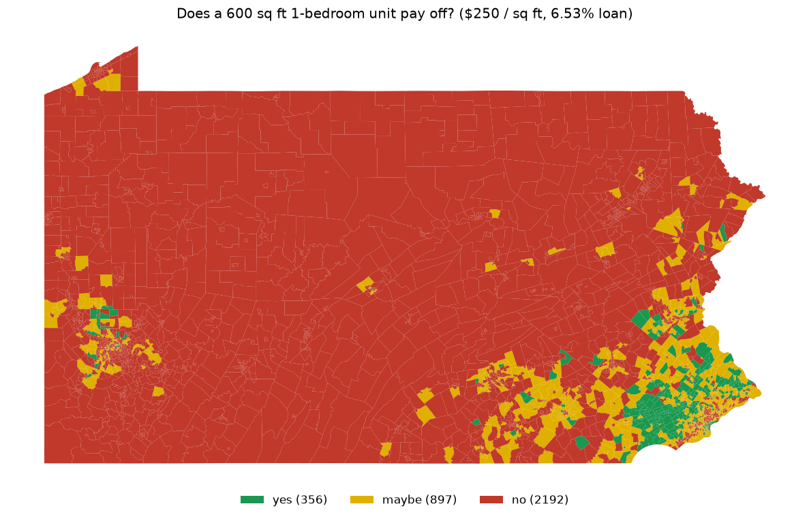
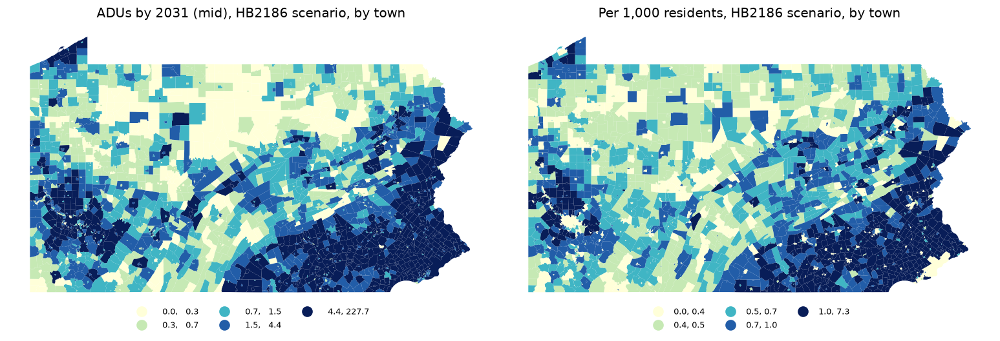

Ye Zhang. MUSA 5500 Geospatial Data Science in Python, Fall 2026. Website: https://yezhanggg.github.io/YZMUSA5500/. Code: https://github.com/yezhanggg/YZMUSA5500

## Introduction

A state bill, HB 2186, would allow a backyard home (an accessory dwelling unit, or ADU) on every home lot in Pennsylvania. SB 1346 would do the same outside Philadelphia and Pittsburgh. Both were still pending on Nov 21, 2026. But legal does not mean built. Philadelphia has allowed ADUs in parts of the city since 2012, and only about 10 have been built legally. ADUs get built where people want to live, where the rent covers the cost, and where the yard has room.

This project asks four questions about the whole state, by 2020 census tract (3,445 tracts) and by town (2,572 county subdivisions):

1. Where are people, homes, jobs and rents growing?
2. Did that change after 2019?
3. Where would a new ADU pay for itself?
4. How many ADUs could be built by 2031, under today's rules and under the state bills?

The results feed a public map and a lot tool for homeowners and planners (https://pa-adu.vercel.app). The lot side, which measures room on each lot, is the MUSA 6950 half of the project.

## Data

All data is free and public, and one script (`get_data.py`) downloads it:

- ACS 5-year (2010-14, 2015-19, 2020-24) and the 2010 and 2020 decennial counts, through the Census API
- LEHD LODES jobs (2010 to 2024), the Census Building Permits Survey, IRS county migration and the Freddie Mac mortgage rate, by scripted download
- Annual NLCD land cover rasters (2010, 2019, 2025) and the OpenStreetMap street network through OSMnx
- HUD Small Area Fair Market Rents, Census TIGER boundaries and a 2010 to 2020 block crosswalk
- Town zoning codes, read by hand into rule files, and the lot records of Philadelphia and Pittsburgh from the 6950 half

## Methods

The four notebooks run in order. The logic of each step is a tested Python module in `pipeline/tract/`.

1. **Trends.** Every source is put on 2020 tracts with the block crosswalk. Dollars are in 2024 terms (CPI-U). Growth is compared before and after 2019 (ACS 2010-14 to 2015-19 against 2015-19 to 2020-24, jobs 2010 to 2019 against 2019 to 2024). Each tract change is checked against its 90% margin of error.
2. **Trend groups.** Six yearly growth rates are standardized and clustered. k from 2 to 10 is scored by silhouette, Davies-Bouldin, the gap statistic and stability across seeds and subsamples (adjusted Rand index). K-means is compared with a Gaussian mixture and Ward clustering.
3. **Land and job access.** Zonal statistics on the NLCD rasters give the developed share of each tract. OSMnx builds the Philadelphia street network and counts the jobs within 30 minutes by car.
4. **Payoff.** A 600 sq ft 1-bedroom unit costs $175, $250 or $300 per sq ft plus 15% soft costs, all borrowed for 30 years at 6.53% (the 2026 average). After 30% of rent goes to vacancy, repairs, tax and insurance, the tract's 1-bedroom rent must cover the payment.
5. **Forecast.** A model predicts housing growth from 2010 to 2020 by tract from 2010 features only. A baseline, ridge, random forest and gradient boosting are compared with counties held out and with 40 km grid blocks held out, plus a five-year backtest and 90% conformal intervals. ADUs by 2031 are scenario arithmetic: people times a permit rate from cities that allow ADUs, scaled by payoff, lots with room, demand and the town's rule.

## Results

**Growth slowed after 2019.** Statewide, job growth fell from 0.95% a year to 0.31%. Real rent growth fell from 0.76% to 0.41%. Housing held near 0.4% a year. Population seems to speed up (0.05% to 0.35%), but part of that comes from the new population base of the 2020-24 ACS. Most single-tract changes are not real signal: about 70% to 85% of them are inside their margin of error. Statewide sums and group medians are firm. One tract alone is not.

**No natural clusters.** Silhouette stays between 0.11 and 0.14 for every k, and the three methods split the tracts very differently (ARI 0.20 to 0.24). K-means with k = 7 is the stable choice (ARI 0.95 across seeds). The groups summarize a smooth spread of growth paths. They are a description, not a finding. One group stands out for ADUs: 478 tracts where real rent fell before 2019 and then rose 4.8% a year.

**An ADU pays in about one tract in ten.** At $250 per sq ft the unit needs $1,562 a month in rent. 356 tracts (10.3%, home to 11.6% of people) pass. Another 26% might. Most passing tracts are in and around Philadelphia: Montgomery has the most (76), then Philadelphia (73) and Chester (67). Build cost moves the answer the most. At $175 per sq ft the share is 36%, and at today's weekly rate of 7.18% it falls to 7.3%. Cheaper building may matter as much as the zoning change.

**Housing growth is only a little predictable.** With counties held out, gradient boosting reaches R2 0.20 with the lowest error (MAE 0.092 log points), against about 0 for the baseline. It was picked over the random forest named in the proposal. Five years ahead the backtest explains only about 2% of the spread, and a tract's own past change says nothing about its next one. The 90% intervals are honest and wide: a tract predicted to grow 5% gets about -14% to +29%. Small tracts with many workers per home and more developed land grow the most.

**Why so few get built today.** The limit differs by place. In Philadelphia the law is the limit: only 1.2% of lots have any legal ADU path, and none can add a new detached unit, even though 73 of its tracts pass the payoff test. In Pittsburgh every lot has a legal path since Oct 2026, and the yard is the limit: a detached unit fits on 66% of lots. Of the 36 largest other towns, 17 have no ADU text in their code and Reading bans them.

**ADUs by 2031.** Under today's rules the stated assumptions give about 1,000 ADUs from 2027 to 2031 (314 to 2,451). Under HB 2186 they give about 13,500 (6,500 to 20,400), about 2,700 a year, or 9% of the homes Pennsylvania permits each year now. SB 1346 gives almost the same total, because it reaches every town but the two cities. The range shows the assumptions, not statistical error. Pennsylvania has no ADU permit series, so the totals cannot be tested against real counts.

## Conclusion

Demand for new homes in Pennsylvania grew more slowly after 2019, and most tract-level changes are too noisy to read alone. A small backyard unit pays for itself in about one tract in ten, mostly around Philadelphia, and build cost matters more than the rent guess or the mortgage rate. Housing growth can be ranked a little better than chance, but not forecast well. The state bills would open many more lots, about thirteen times today's number of ADUs by 2031, yet the total stays small next to all new housing because most places fail the payoff test.

Three things would change the answer the most. Lower build costs would help more than any rate change. Reading more town codes matters too: 71% of people live in towns whose code was not read in this run, so "today" rests on a default. And measuring lots with room beyond the two cities would replace an extrapolation (61% of other tracts are outside the range of the training cities).

**Limits.** ACS tract data is noisy and the 2020-24 base changed. The crosswalk splits by land area. The payoff test is a screen with one cost and one running cost share. The forecast factors are judgment calls, written down in `shared/assumptions.json`. Job access covers only Philadelphia, so it is not in the model.

Full tables and figures are in [docs/results.md](https://github.com/yezhanggg/YZMUSA5500/blob/main/docs/results.md) and every step can be rerun from the [notebooks](https://yezhanggg.github.io/YZMUSA5500/#/notebooks).
